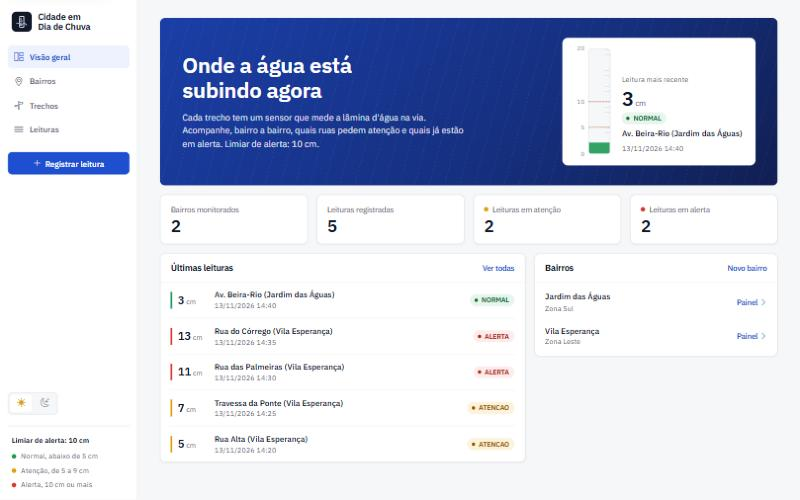
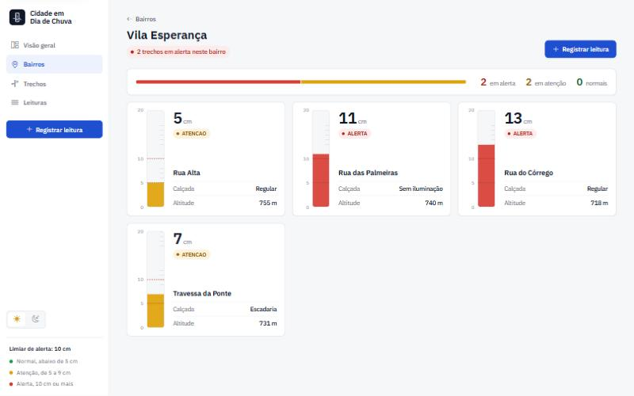
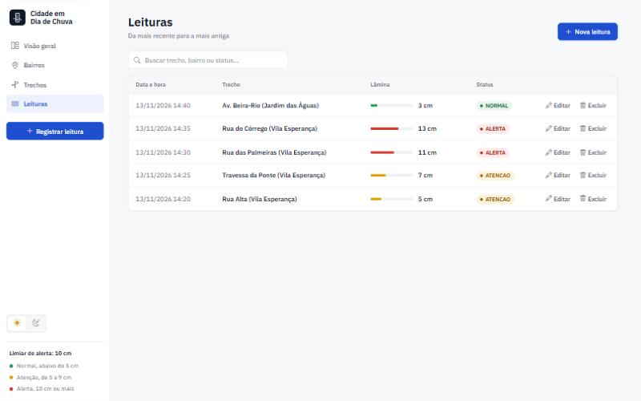
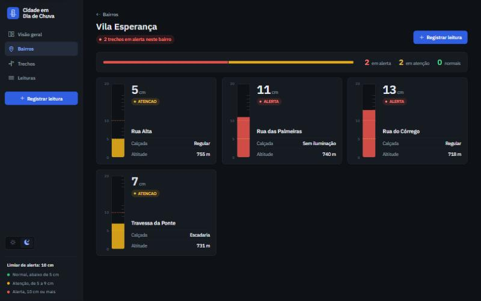

# Cidade em Dia de Chuva

Sistema web para a Defesa Civil acompanhar a lâmina d'água nas ruas em dias de chuva.
Cada trecho de rua tem um sensor; o sistema registra as leituras, calcula o status de cada uma
e mostra, bairro a bairro, quais trechos estão normais, em atenção ou em alerta.

Projeto acadêmico em equipe, desenvolvido na Global Solution 2026.2 (tema CitizenTech) da FIAP,
na disciplina de Programação Orientada a Objetos com Java e WEB.

## Funcionalidades

- Cadastro de bairros, trechos e leituras (incluir, alterar, excluir e listar)
- Status da leitura calculado pelo sistema a partir da lâmina: NORMAL, ATENCAO ou ALERTA
- Painel do bairro com a última leitura de cada trecho e a contagem por status
- Regras de exclusão: bairro com trechos não pode ser excluído; excluir um trecho apaga as leituras dele
- Validação dos formulários com mensagens no próprio campo
- Busca nas listas e tema claro ou escuro

| Painel do bairro | Leituras |
|---|---|
|  |  |

## Tecnologias

- Java 17 e Maven
- Spring Boot 3.5 (Spring Web, Spring Data JPA, Bean Validation)
- Thymeleaf, HTML, CSS e JavaScript
- Banco de dados Oracle
- Lombok

## Arquitetura

O projeto é organizado em camadas, dentro do pacote `br.fiap.joao565291`:

| Pacote | Papel |
|---|---|
| `domain` | Entidades JPA: `Bairro`, `Trecho` e `Leitura` |
| `dto` | Objetos que trafegam entre o controller e o service |
| `mapper` | Conversão entre DTO e entidade, escrita à mão |
| `repository` | Interfaces Spring Data JPA, com consultas pelo nome do método |
| `service` | Regras de negócio e montagem do painel |
| `controller` | Rotas e telas Thymeleaf |
| `exception` | Exceções de registro não encontrado e de regra de negócio |

### Regras de negócio

- **Status da leitura** (`LeituraService`): com limiar de alerta de 10 cm, a leitura é NORMAL abaixo de 5 cm,
  ATENCAO de 5 a 9 cm e ALERTA a partir de 10 cm. O status é recalculado quando a leitura é alterada.
- **Exclusão de bairro** (`BairroService`): recusada quando o bairro tem trechos.
- **Exclusão de trecho** (`TrechoService`): apaga as leituras do trecho e depois o trecho, na mesma transação.

## Como executar

1. Tenha o Java 17 e acesso a um banco Oracle.
2. Ajuste a URL do banco em `src/main/resources/application.properties`, se necessário.
3. Defina as variáveis de ambiente `DB_USER` e `DB_PASSWORD` com o usuário e a senha do banco.
4. Execute a classe `Joao565291Application` (ou `./mvnw spring-boot:run`).
5. Acesse http://localhost:8080.

As tabelas `GS316_BAIRRO`, `GS316_TRECHO` e `GS316_LEITURA` são criadas pelo Hibernate na primeira execução.

## Equipe

- Breno Eiki
- João Pedro Crivelli F Alves
- Rodrigo Sun Zheng
